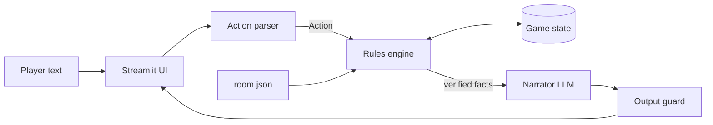

# AI-Escape-Room

An interactive text escape room where an LLM acts as the **Game Master**. The project is built in two
versions to show why "just prompt the LLM" is fun but fragile, and how to make it reliable.

| | Version 1 | Version 2 |
|---|---|---|
| Who decides what is allowed? | The LLM | Python rules engine |
| Where are the secrets? | Inside the prompt | `v2/config/room.json`, never sent to the LLM |
| Game memory | Chat history only | Structured state (dictionary) |
| Win detection | LLM prints `[ESCAPED]` | Python flag `escaped` |
| Works offline? | No | Yes (rules engine + plain text) |

## The game
You wake up in a locked library. Examine objects, collect items, solve three puzzles and escape:
1. Find a magnifying glass, read four tiny numbers on the bookshelf, open the drawer.
2. Take the brass key, move the painting, open the hidden wall safe.
3. Combine the safe's riddle with the date on the painting plaque and enter it on the door keypad.

Objects: desk, bookshelf, painting, drawer, wall safe, door. Items: magnifying glass, brass key.

## Architecture
Version 1: 

Version 2: 



## Technologies
Python 3.10+, Streamlit, Google Gemini API (`google-genai`), python-dotenv, pytest.

## Install and run
```bash
git clone https://github.com/<your-username>/AI-Escape-Room.git
cd AI-Escape-Room
python -m venv .venv
source .venv/bin/activate          # Windows: .venv\Scripts\activate
pip install -r requirements.txt
cp .env.example .env               # Windows: copy .env.example .env
# open .env and paste your key from https://aistudio.google.com/apikey

streamlit run v1/app.py            # Version 1 (needs the API key)
streamlit run v2/app.py            # Version 2 (works without a key, better with one)
```
Never commit `.env`. It is listed in `.gitignore`.

## Tests
```bash
cd v2 && python -m pytest tests -q          # 19 automated tests, no API key needed
python tests/live_attack_demo.py            # runs 6 attacks on V1 (needs key) and V2 (offline)
```

## Test cases
See [docs/TEST_CASES.md](docs/TEST_CASES.md) for the five+ cases comparing Version 1 and Version 2.

## Development story
- **Version 1** is one prompt plus chat history. It is quick to build and feels natural, but the LLM
  can forget, invent objects, leak clues, and be talked into ignoring the rules.
- **Version 2** moves all decisions into Python: structured state, action validation, inventory rules,
  an output guard, and a narrator that only sees verified facts.

## Screenshots
Add your own to `docs/screenshots/` (gameplay V1, gameplay V2, the "Show game state" panel, test output).

## Known limitations
- The keyword parser understands a limited vocabulary; Gemini parsing is broader.
- The output guard checks digits and victory phrases; it cannot detect every invented detail.
- Spelled-out numbers ("four one seven three") would not be caught by the guard.
